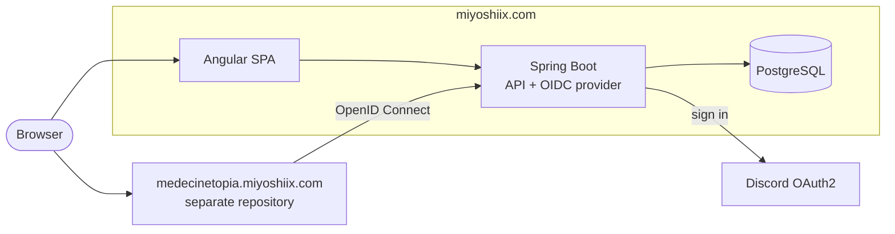

# MiYoshiix Portal

[](https://github.com/Niviferum/Miyoshiix-Portal/actions/workflows/ci.yml)
[](https://miyoshiix.com)
[](LICENSE)

A private portal that gathers my wife's everyday modules behind a single Discord login.

The portal lives at `miyoshiix.com`. It signs users in with Discord and checks each account against an allowlist. It then shows a tile for each module the user is allowed to open. Each module is a separate site on its own subdomain (`<module>.miyoshiix.com`), kept in its own repository. Modules do not talk to Discord: they sign users in through the portal, which acts as their OpenID Connect provider.

## Features

- **Discord sign-in with an allowlist.** Discord proves who the user is. The `app_user` table decides whether they get in, and with which role (`USER` or `ADMIN`).
- **Server-side session.** The session lives in an `HttpOnly` cookie, with no token in `localStorage`. CSRF protection and a strict Content Security Policy are on.
- **OpenID Connect provider for modules.** Built on Spring Authorization Server: authorization code flow with PKCE (S256) required, exact redirect URIs, a minimum role per module, and RP-initiated logout.
- **Module catalog as configuration.** Adding a module is one entry in `application.yml`. That entry sets its tile, its URL, its minimum role and its OIDC client, all validated at startup.
- **Accessible, understated UI.** The Angular front has a sober, corporate-futuristic look in green, black and white, with light and dark themes and a global switch to turn animations off. It follows RGAA (French accessibility guidelines).

## Architecture



Spring Boot serves the built Angular app, so production runs as a single service.

## Tech stack

| Layer | Technology | Version |
|---|---|---|
| Language | Java | 21 |
| Backend | Spring Boot (Spring Framework 7, Spring Security 7.1) | 4.1.1 |
| Identity provider | Spring Authorization Server | bundled with Spring Security |
| Persistence | Hibernate / Spring Data JPA | 7.4.5 |
| Migrations | Flyway | 12.4.0 |
| Database | PostgreSQL | 17 (local), 18 (Railway) |
| Frontend | Angular | 22.1 |
| Runtime | Node.js | 24.21.0 |
| Tests | JUnit 5, Testcontainers, Vitest | |
| Hosting | Docker on Railway | |

## Repository layout

```
.
├── backend/              Spring Boot application
│   └── src/main/java/com/miyoshix/portal/
│       ├── api/          REST controllers (/api/me, /api/modules)
│       ├── config/       Security chain, CSRF, SPA serving
│       ├── modules/      Module catalog and its validation
│       ├── oidc/         OpenID Connect provider for modules
│       ├── security/     Discord sign-in, session identity
│       └── user/         Allowlist
├── frontend/             Angular application (login and home pages)
├── docker-compose.yml    Local PostgreSQL
├── Dockerfile            Production image: Angular build + Spring Boot jar
├── railway.json          Railway build and health check
└── .env.example          Template for local environment variables
```

## Getting started

### Prerequisites

- Java 21. The Maven Wrapper is included, so you do not need to install Maven.
- Node.js 24.15 or later. Angular 22 does not run on older versions.
- Docker, for PostgreSQL and the integration tests.
- A Discord application, created at <https://discord.com/developers/applications>.

### 1. Configure the environment

```bash
cp .env.example .env
```

Fill in `.env`. Every variable is described in the file itself. In the Discord application, under **OAuth2 > Redirects**, add both of these:

```
http://localhost:4200/login/oauth2/code/discord
http://localhost:8080/login/oauth2/code/discord
```

`PORTAL_BOOTSTRAP_ADMIN` holds your own Discord ID. It creates the first allowed account, with the `ADMIN` role.

### 2. Start the database

```bash
docker compose up -d
```

Flyway creates the schema when the backend starts.

### 3. Run the backend

```bash
cd backend
set -a && . ../.env && set +a
./mvnw spring-boot:run
```

The API listens on <http://localhost:8080>.

### 4. Run the frontend

```bash
cd frontend
npm ci
npm start
```

Open <http://localhost:4200>. The dev server forwards `/api`, `/oauth2` and `/login/oauth2` to the backend.

## Configuration

| Variable | Purpose |
|---|---|
| `DB_URL`, `DB_USER`, `DB_PASSWORD` | PostgreSQL connection (JDBC URL) |
| `DISCORD_CLIENT_ID`, `DISCORD_CLIENT_SECRET` | Discord OAuth2 application |
| `PORTAL_BOOTSTRAP_ADMIN` | Discord ID of the first administrator |
| `PORTAL_ISSUER` | Public URL of the portal, used as the OIDC issuer |
| `PORTAL_OIDC_SIGNING_KEY` | RSA private key (PKCS#8, base64 DER) that signs module tokens. Leave it empty locally to use a temporary key |
| `COOKIE_SECURE` | `true` in production (HTTPS only) |
| `MODULE_<NAME>_URL`, `_ENABLED`, `_CLIENT_SECRET` | Per-module settings |

To generate a signing key on one line:

```bash
openssl genpkey -algorithm RSA -pkeyopt rsa_keygen_bits:2048 \
  | openssl pkcs8 -topk8 -nocrypt -outform DER | base64 -w0
```

Never commit secrets. `.env` is ignored by git, and `.dockerignore` keeps it out of the image.

## Adding a module

A module is built and deployed from its own repository. On the portal side, declare it in `backend/src/main/resources/application.yml`:

```yaml
portal:
  modules:
    - key: medecinetopia            # also the OIDC client_id
      label: Médecinetopia
      icon: medecinetopia.svg       # optional, file in frontend/public/icons/modules/
      url: ${MODULE_MEDECINETOPIA_URL}/
      minimum-role: USER
      enabled: ${MODULE_MEDECINETOPIA_ENABLED:false}
      client:
        client-secret: ${MODULE_MEDECINETOPIA_CLIENT_SECRET:}
        redirect-uris:
          - ${MODULE_MEDECINETOPIA_URL}/login/oauth2/code/miyoshiix
        post-logout-redirect-uris:
          - ${MODULE_MEDECINETOPIA_URL}/
```

The portal refuses to start if a module URL is not HTTPS (HTTP is allowed only on `localhost`). It also refuses redirect URIs on a different site from the module's URL.

The module then connects as a standard OIDC client:

| Setting | Value |
|---|---|
| Discovery | `https://miyoshiix.com/.well-known/openid-configuration` |
| Client ID / secret | the module `key` / `MODULE_<NAME>_CLIENT_SECRET` |
| Flow | Authorization code with PKCE (S256) |
| Scopes | `openid profile` |
| Claims | `sub` (Discord ID), `name`, `picture`, `role` |

### Running a module locally

The portal and the module run side by side, each with its own database. Example with [Crochedex](https://github.com/Niviferum/crochedex) on port 8082:

1. In the portal's `.env`, enable the module and give it a secret:

   ```bash
   MODULE_CROCHEDEX_URL=http://crochedex.localhost:8082
   MODULE_CROCHEDEX_ENABLED=true
   MODULE_CROCHEDEX_CLIENT_SECRET=   # openssl rand -base64 32
   ```

2. In the module's `.env`, set `PORTAL_ISSUER=http://localhost:8080` and the same secret (`PORTAL_CLIENT_SECRET` for Crochedex).
3. Start the portal (database, backend, frontend) as in [Getting started](#getting-started), then the module:

   ```bash
   cd ../crochedex
   docker compose up -d                 # its own PostgreSQL, on 5434
   cd backend
   set -a && . ../.env && set +a
   ./mvnw spring-boot:run               # http://localhost:8082
   ```

4. Sign in on <http://localhost:4200> and click the module's tile. It opens `http://crochedex.localhost:8082/`. Browsers resolve `*.localhost` to the local machine, so `/etc/hosts` needs no change. The module sends you back to the portal, which already knows you and returns you to the module without going through Discord again.

Things to keep in mind:

- The portal reads `.env` and `application.yml` only at startup. Restart it after changing either.
- Without `PORTAL_OIDC_SIGNING_KEY`, the portal signs tokens with a new key at each start. Sign in to the module again after restarting the portal.
- Give each module its own port (8081 is taken by Médecinetopia) and its own session cookie name, distinct from `MIYOSHIX_SESSION`.

## Testing

```bash
cd backend && ./mvnw test                   # unit, integration and end-to-end tests (needs Docker)
cd frontend && npm test -- --watch=false    # Vitest unit tests
```

The backend's end-to-end tests run the real HTTP server against a fake Discord and a PostgreSQL container. They cover sign-in, the allowlist, CSRF, security headers, and the full OIDC flow for modules, including logout.

## Deployment

The portal is deployed on [Railway](https://railway.com) from the `Dockerfile`:

1. The Docker build compiles the Angular app and packages it inside the Spring Boot jar.
2. The final image runs on a JRE as a non-root user.
3. Railway checks `/actuator/health` before sending traffic to a new deployment.

GitHub Actions runs both test suites on every push (`.github/workflows/ci.yml`). With **Wait for CI** enabled on the Railway service, a commit is deployed only once those checks pass.

Production settings:
- **Railway variables:** `PORT=8080`, `COOKIE_SECURE=true` and `PORTAL_ISSUER=https://miyoshiix.com`. Take the database variables from the Postgres service.
- **Discord redirect URL:** `https://miyoshiix.com/login/oauth2/code/discord`.
- **HTTPS:** Railway terminates it. The app reads the `X-Forwarded-*` headers to build its public URLs.

## Security

- The Discord allowlist is checked on every sign-in. Disabled or unknown accounts are rejected.
- All database queries go through JPA with bound parameters.
- The response headers include a strict CSP, `X-Frame-Options: DENY`, `Referrer-Policy` and HSTS in production.
- Angular escapes interpolated content by default, and the code never bypasses its sanitizer.
- Tokens issued to modules are signed with RS256 and are short-lived. The portal only redirects to addresses registered for the module.

## Roadmap

- [x] Discord sign-in and allowlist
- [x] Accessible frontend
- [x] OpenID Connect provider for modules
- [x] Modules as separate subdomains
- [x] Railway deployment
- [ ] First module: Médecinetopia (rewrite in progress)
- [ ] Rate limiting on sign-in
- [ ] Persistent sessions (Spring Session JDBC)

## License

Released under the [MIT License](LICENSE). You are free to reuse this code, provided the copyright notice and license text are kept.
